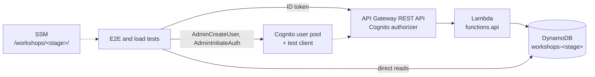

In [Serverless Python Microservices on AWS: My Reference Architecture](TODO-link) the testing
part is three sentences long. Fakes for the domain, moto for the adapters, end-to-end tests
against a real environment. That is true, but it skips the interesting part: *which* bug does
each of those levels catch, and why does the level before it miss it?

This post is the long version. I built a small service, planted eight bugs in it and wrote the
test that catches each one. Every level of the pyramid gets exactly one bug that only it finds.
No level replaces another. Each one is the cheapest place to catch a particular class of bug.

All code is on GitHub: [python-aws-testing-pyramid](https://github.com/andreas-john-dev/python-aws-testing-pyramid).
The code there is correct. Every bug lives as a patch in `docs/bugs/`, so you can plant it with
`make bug-<n>`, watch the right test fail and revert it with `make unbug`.

## At a Glance

| Level | Runs against | When | Finds |
|---|---|---|---|
| Unit | Domain model, fakes | Every `make test`, ~1 s | Wrong business rules |
| Contract | Fake, moto, real DynamoDB | `make test` (fake, moto), `make test-aws` | A fake that lies |
| Integration: DynamoDB | moto, real DynamoDB | `make test`, `make test-aws` | Mapping and type errors, wrong table setup |
| Integration: handler | Lambdalith on moto | `make test` | Routing, validation, error mapping |
| Architecture | Import graph | `make test` | Dependencies that break the hexagon |
| E2E | API Gateway, Lambda, DynamoDB | After each deploy | IAM, authorizer, wiring |
| Load | A stage of its own | Manually | Behaviour under real concurrency |

And the eight bugs:

| # | Level | Bug | Why the level before misses it |
|---|---|---|---|
| 1 | Unit | Capacity counts cancelled registrations | First level |
| 2 | Contract | The fake does not check `version` on save | Unit tests only run against the fake |
| 3 | Integration (moto) | `starts_at` stored as a `timestamp()` float | The fake stores Python objects in a dict |
| 4 | Integration (real DynamoDB) | CDK creates the GSI with `KEYS_ONLY` | moto builds its table from `schema.py`, not from CDK |
| 5 | Integration (handler) | A conflict becomes 500 instead of 409 | Unit tests call use cases, not the handler |
| 6 | Architecture | A use case catches botocore's `ClientError` | All tests stay green, boto3 is in the shared `.venv` |
| 7 | E2E | The Lambda policy misses the index | moto checks no IAM, and the AWS tests run with a broader role |
| 8 | Load | `TransactionConflict` is not translated | Single requests cause no transaction conflicts |

## The Example Service

The domain is workshop registrations. It is small on purpose. Big enough for the unit tests to
have something to check, small enough not to dominate the post.

A workshop has a fixed number of seats. Signed-in users book one or two of them.

- Active seats never exceed the capacity. Cancelled registrations do not count.
- A person holds at most two seats per workshop.
- Cancelling is possible until 48 hours before the start, and only by the person who registered.
- No registrations after the start.
- Every save increments the workshop's `version`. Saving a stale version fails (optimistic locking).

The layout follows the reference architecture: a uv workspace with a `_domain` package, an
`_infra` package and a Lambdalith with the Powertools router. CDK deploys a shared, a stateful and
a stateless stack.

```
services/workshops/
├── workshop_service_domain/   # pydantic: models, rules, ports, use cases
├── workshop_service_infra/    # boto3: DynamoDB adapter, SystemClock, schema.py
└── functions/                 # functions.api: build_app() and the handler
```

The domain defines two ports:

```python
class WorkshopRepository(Protocol):
    def get(self, workshop_id: str) -> Workshop | None: ...
    def save(self, workshop: Workshop) -> None: ...  # raises ConcurrentUpdateError
    def list_upcoming(self, now: datetime) -> list[Workshop]: ...


class Clock(Protocol):
    def now(self) -> datetime: ...
```

There is no DynamoDB term in them. No `pk`, no `LastEvaluatedKey`. Part 2 of this series puts a
SQL adapter behind the same port, and neither the domain nor the unit tests will change.

The use cases get their dependencies through the constructor. `RegisterForWorkshop` and
`CancelRegistration` reload and retry up to three times on a `ConcurrentUpdateError`, with
exponential backoff and jitter. The backoff is a constructor parameter, so tests pass zero.

## Unit Tests: Fakes Instead of Patching

The unit tests check rules and use cases. No AWS, no moto, no `mock.patch`, no `MagicMock`, no
freezegun. Time comes only through the `Clock` port.

Most rules are checked directly on the `Workshop` aggregate, without any fake:

```python
def test_cancelled_registrations_do_not_count_towards_capacity() -> None:
    workshop = make_workshop(capacity=2)
    registration = workshop.register("alice", 2, NOW)
    workshop.cancel(registration.id, "alice", NOW)

    workshop.register("bob", 2, NOW)

    assert workshop.free_seats == 0
```

The use-case tests get a `FakeWorkshopRepository` and a `FakeClock` through the constructor.
Two details make the fake worth having:

1. **It stores deep copies.** `get` and `save` both copy with `model_copy(deep=True)`. Without
   that, a test that changes a loaded workshop and forgets to call `save` still passes, because
   the "stored" object is the same object.
2. **It checks the version like the real adapter.** For the retry test it offers a test control
   instead of patching: `fail_next_save_with_conflict(times=2)`.

```python
def test_register_retries_after_a_conflict(repository, clock) -> None:
    workshop = make_workshop()
    repository.save(workshop)
    repository.fail_next_save_with_conflict(times=2)

    RegisterForWorkshop(repository, clock, NO_WAIT)(workshop.id, "alice", 1)

    assert repository.save_calls == 1 + 3
```

The cancellation deadline is tested on both edges: exactly 48 hours before the start, and one
microsecond later. With a `FakeClock` that is two lines, not a freezegun context.

### Bug 1: Capacity Counts Cancelled Registrations

```diff
-        return sum(r.seats for r in self.registrations if r.is_active)
+        return sum(r.seats for r in self.registrations)
```

```
____ test_cancelled_registrations_do_not_count_towards_capacity ____
E   workshop_service_domain.errors.CapacityExceeded: 0 seats left
FAILED tests/unit/test_workshop.py::test_cancelled_registrations_do_not_count_towards_capacity
FAILED tests/unit/test_use_cases.py::test_cancel_retries_after_a_conflict
```

This is the cheapest bug in the post. It runs in milliseconds and needs nothing but Python.
Every rule that can be checked here should be checked here.

## Contract Tests: Keeping the Fake Honest

The most common objection to fakes is that they drift. The fake says one thing, the real
database does another, and the unit tests stay green on a fiction.

Contract tests are the answer. One test suite describes how *every* `WorkshopRepository` must
behave, and a fixture runs it against all of them:

```python
# One parameter per adapter. Part 2 adds "sql" here and nothing else.
@pytest.fixture(params=[FAKE, MOTO, pytest.param(AWS, marks=pytest.mark.aws)])
def repository(request):
    if request.param == FAKE:
        yield FakeWorkshopRepository()
    elif request.param == MOTO:
        with moto_table() as table:
            yield tracked_repository(table)
    else:
        yield tracked_repository(request.getfixturevalue("aws_table"))
```

The suite checks a round trip with time zones, `get` with an unknown id, a stale save, that
cancelled registrations are kept, and that `list_upcoming` skips past workshops and sorts by
start. `fake` and `moto` run on every `make test`. `aws` runs with `make test-aws` against the
deployed stage's table.

Only the `aws` variant proves that the fake behaves like real DynamoDB, not just like moto.

### Bug 2: The Fake Does Not Check the Version

```diff
-        stored = self._workshops.get(workshop.id)
-        stored_version = stored.version if stored else 0
-        if stored_version != workshop.version:
-            raise ConcurrentUpdateError(workshop.id)
```

All unit tests stay green. The retry test uses `fail_next_save_with_conflict()`, which still
works. Nothing in the unit tests ever saves a stale version for real.

```
____ test_save_with_stale_version_raises[fake] ____
E   Failed: DID NOT RAISE ConcurrentUpdateError
FAILED tests/contract/test_workshop_repository.py::test_save_with_stale_version_raises[fake]
FAILED tests/contract/test_workshop_repository.py::test_two_new_workshops_with_the_same_id_conflict[fake]
```

The `[moto]` variant of the same test passes. The difference between the two lines is the whole
argument for contract tests.

While building the repository, the contract tests also found a real difference between fake and
adapter that I had not planted. Two registrations created at the same instant came back in a
different order from DynamoDB than from the fake. The aggregate now keeps registrations ordered
by `(created_at, id)` itself. Without contract tests, that would have been a flaky test somewhere
much later.

## Integration Tests: DynamoDB With moto and With the Real Thing

The fake cannot tell you anything about DynamoDB items. That is what the integration tests are
for: number types, the datetime round trip, the content of the transaction, the GSI query.

The adapter keeps one table with `pk` and `sk`:

| Item | `pk` | `sk` |
|---|---|---|
| Workshop | `WORKSHOP#<id>` | `META` |
| Registration | `WORKSHOP#<id>` | `REG#<id>` |

`get` is a strongly consistent query on `pk`. `save` is one `TransactWriteItems`: a conditional
update of `META` on `version`, plus a put of every registration that changed. Every item also
carries `gsi1pk=WORKSHOPS` and `gsi1sk=<starts_at>#<id>#<sk>`, so a single query on `gsi1` returns
whole upcoming workshops. Timestamps are fixed-width ISO 8601 strings in UTC, so string order is
time order.

The key names and the GSI live in one file, `schema.py`. The adapter, the moto fixture and the
CDK stack all read them from there.

The same tests run against two backends:

```python
DYNAMODB_BACKENDS = [MOTO, pytest.param(AWS, marks=pytest.mark.aws)]

@pytest.fixture(params=DYNAMODB_BACKENDS)
def dynamodb_table(request):
    if request.param == AWS:
        yield request.getfixturevalue("aws_table")
    else:
        with moto_table() as table:
            yield table
```

A few details matter here:

- **The adapter gets its boto3 client through the constructor.** No test depends on a global
  default session.
- **The moto fixture does not touch environment variables.** It creates its own session with
  dummy credentials. So the real credentials for the `aws` variant stay intact.
- **The `aws` variant uses the stage's real table.** The name comes from SSM, the credentials
  from the environment. Locally that is the developer role, in CI the pipeline role. There is
  no separate test role.
- **Missing credentials fail the run.** These tests only run when started explicitly. A silent
  skip would be a false green in CI.
- **The GSI is eventually consistent.** The `aws` variant polls briefly after a write. moto
  returns on the first try, so the same helper works for both.

### Bug 3: `starts_at` as a Float

```diff
-                        ":starts_at": _iso(workshop.starts_at),
+                        ":starts_at": workshop.starts_at.timestamp(),
```

The fake stores Python objects in a dict, so it does not care. moto does:

```
FAILED tests/integration/dynamodb/test_dynamodb_repository.py::test_items_have_the_documented_layout[moto]
FAILED tests/integration/dynamodb/test_dynamodb_repository.py::test_timestamps_are_utc_iso_strings_and_numbers_are_numbers[moto]
...
E   TypeError: Float types are not supported. Use Decimal types instead.
```

The `[moto]` variant of the contract tests fails too. That is fine: the bug is caught on the
first level that talks to something DynamoDB-shaped.

### Bug 4: The GSI Projection

The original plan for this level was a different bug: querying the GSI with
`ConsistentRead=True`, which DynamoDB rejects. I checked before building it, and moto rejects it
too:

```
ValidationException: Consistent reads are not supported on global secondary indexes
```

moto is good at validating API calls. What it cannot know is how *your* table was actually
created. The moto fixture builds its table from `schema.py`. The real table comes from CDK.
So bug 4 is a CDK stack that does not use `schema.py` for the projection:

```diff
-                    projection_type=dynamodb.ProjectionType(schema.GSI1_PROJECTION),
+                    projection_type=dynamodb.ProjectionType.KEYS_ONLY,
```

`make test` stays green. Against the deployed table:

```
FAILED tests/contract/test_workshop_repository.py::test_list_upcoming_skips_past_workshops_and_sorts[aws] - KeyError: 'title'
FAILED tests/integration/dynamodb/test_dynamodb_repository.py::test_list_upcoming_reads_whole_workshops_from_the_index[aws] - KeyError: 'user_id'
================= 2 failed, 12 passed, 22 deselected in 30.60s =================
```

The index only returns the keys, so the adapter finds neither `title` on the META item nor
`user_id` on a registration. The fix for the class of bug is the single source of truth in
`schema.py`. The test for it is the same integration test, run against the table CDK really
created.

What moto does not cover is worth naming: IAM, throttling, some validations and anything that
only happens under concurrency. And even single requests against real DynamoDB miss the last
two. That is what the remaining levels are for.

## Integration Tests: The Lambdalith Handler

The handler module is thin. `functions/api` separates `build_app(repository, clock)` from the
Lambda entry point. The handler builds the production instance, the tests call `build_app` with
their own dependencies: the DynamoDB adapter on moto and a `FakeClock`.

A fixture builds REST API proxy events with authorizer claims:

```python
def api_event(method, path, body=None, user_id="alice"):
    authorizer = {"claims": {"sub": user_id}} if user_id else {}
    return {"httpMethod": method, "path": path, "body": json.dumps(body),
            "requestContext": {"authorizer": authorizer, ...}, ...}
```

The tests check routing, validation, error mapping and the response schema:

| Endpoint | Success | Errors |
|---|---|---|
| `POST /workshops` | 201 | 400 on an invalid body |
| `GET /workshops` | 200, upcoming only | |
| `GET /workshops/{id}` | 200, with free seats | 404 |
| `POST /workshops/{id}/registrations` | 201 | 404, 422 (rules), 409 (conflict after retries) |
| `DELETE /workshops/{id}/registrations/{rid}` | 204 | 403, 404, 422, 409 |

Missing claims give 401. Rule violations from the domain give 422. A `ConcurrentUpdateError`
after all retries gives 409. The mapping is one explicit table in the app, and anything not in
it becomes a logged 500.

### Bug 5: A Conflict Becomes 500

```diff
     WorkshopAlreadyStarted: HTTPStatus.UNPROCESSABLE_ENTITY,
-    ConcurrentUpdateError: HTTPStatus.CONFLICT,
```

The unit tests call the use case and see the `ConcurrentUpdateError`, exactly as intended.
They never see the HTTP status:

```
____ test_conflict_after_all_retries_is_409 ____
E   AssertionError: assert (<HTTPStatus....lServerError') == (409, 'ConcurrentUpdateError')
E     At index 0 diff: <HTTPStatus.INTERNAL_SERVER_ERROR: 500> != 409
FAILED tests/integration/api/test_handler.py::test_conflict_after_all_retries_is_409
```

A 500 instead of a 409 is not cosmetic. A client retries a 409. A 500 lands on someone's alerting
dashboard.

## Architecture Tests

I wrote about the approach in [Enforcing Python Architecture Rules with PyTestArch](TODO-link).
For this layout the rules are:

1. `workshop_service_domain` imports neither boto3, botocore, `workshop_service_infra` nor `functions`.
2. `workshop_service_infra` does not import `functions`.
3. Only `functions.api` imports `workshop_service_infra`.
4. `tests/unit` imports neither `workshop_service_infra` nor moto, boto3, botocore, `unittest` or freezegun.

Rule 4 keeps the unit tests honest: fakes only, no patching.

Why does this need a test at all? The domain has its own `pyproject.toml` with only pydantic in
it. But locally every workspace package shares one `.venv`, and in Lambda boto3 is there anyway.
The `pyproject.toml` prevents nothing.

Two things I learned about PyTestArch on the way. It refuses rules on modules that nothing in
the scanned tree imports, which is the normal case for a forbidden module, so the helper only
passes modules that are actually imported. And `from unittest import mock` only shows up as an
import of `unittest`, so rule 4 forbids all of `unittest`.

### Bug 6: A Use Case Catches `ClientError`

```diff
+from botocore.exceptions import ClientError
 ...
-        except ConcurrentUpdateError:
+        except (ConcurrentUpdateError, ClientError):
```

It looks defensive. It even feels responsible. And every functional test stays green, because
the code still works. Only the import graph shows it:

```
E   AssertionError: "workshop_service_domain.use_cases" imports "botocore.exceptions".
FAILED tests/architecture/test_import_rules.py::test_domain_has_no_infrastructure_imports
```

The domain now knows it runs on AWS. In Part 2 the SQL adapter would raise something else
entirely, and the retry would silently stop covering it.

## What the AWS Tests Run Against

The infrastructure exists so that the E2E and load tests have something to run against. A CDK
app in Python, parametrised by `STAGE`, with three stacks:



- **shared**: the Cognito user pool and an app client only for tests, without a client secret
  and with `ALLOW_ADMIN_USER_PASSWORD_AUTH`. It exists only in non-production stages.
- **stateful**: the table `workshops-<stage>`, keys and GSI from `schema.py`.
- **stateless**: the Lambdalith (Python 3.14, arm64, packaged with uv as in
  [AWS Lambda Packaging with Python and uv](TODO-link)) and a REST API with a Cognito
  authorizer.

API URL, table name, user pool id and test client id go to SSM under `/workshops/<stage>/`.
Every branch gets its own stage. Without a relational database that is cheap and fast.

## E2E Tests Through API Gateway

The E2E tests run after the deploy and go exclusively through API Gateway, with a real Cognito
token. Every request passes the authorizer, the Lambda and the Lambda's IAM role. That makes
this the only level that tests the Lambda's IAM policy.

A session fixture creates two Cognito users per run, `alice` and `bob`:
`AdminCreateUser` with `MessageAction=SUPPRESS`, `AdminSetUserPassword` with `Permanent=True`,
then `AdminInitiateAuth` with `ADMIN_USER_PASSWORD_AUTH` on the test client. Two users, because
rules depend on identity: the seat limit per person, cancelling only your own registration.
`AdminDeleteUser` removes both at the end, also when tests fail.

Every writing test checks two things: the API response *and* the items in DynamoDB.

```python
def test_bob_cannot_cancel_alices_registration(alice, bob, users, new_workshop, state):
    workshop = new_workshop()
    registration = expect(alice.register(workshop["id"], 1), 201)
    before = state.read(workshop["id"])

    expect(bob.cancel(workshop["id"], registration["id"]), 403)

    assert state.read(workshop["id"]) == before
```

The state reader reads raw items with a strongly consistent query, not through the adapter. A
mapping bug that writes and reads the same wrong value would be invisible through the adapter.
It translates the items into a neutral state: version, and per registration `user_id`, seats
and status. Part 2 adds a SQL state reader for the same assertions.

Why look into the table at all, when the API answers are right? Because if the Lambda wrote to
another stage's table, say through a wrong SSM path, the API answers would still agree with each
other. Only a look into the expected table shows it.

The cancellation deadline needs no time travel here: a workshop in 24 hours gives 422 on cancel,
one in seven days gives 204.

The test set also covers every DynamoDB operation the Lambda performs: a query on the table
(`get`), a query on the GSI (`list_upcoming`) and `TransactWriteItems` (`save`). If the Lambda
lacks a permission, the API answers 500, and the test prints the `x-amzn-RequestId` so the
`AccessDenied` in the Lambda log is one search away.

### Bug 7: The Lambda Policy Misses the Index

```diff
-        table.grant_read_write_data(function)
+        function.add_to_role_policy(
+            iam.PolicyStatement(
+                actions=["dynamodb:Query", "dynamodb:PutItem", "dynamodb:UpdateItem"],
+                resources=[table.table_arn],
+            )
+        )
```

A hand-written policy that looks complete. It allows the table but not `table/*/index/*`.

Why does nothing before E2E catch it? moto checks no IAM. And the AWS integration tests run with
the developer or pipeline role, not with the Lambda role. Those roles usually have broader
rights. They test the adapter, not the Lambda's policy.

```
E   AssertionError: GET /api/workshops: expected 200, got 500 {"error":"InternalServerError","message":"internal error"} (x-amzn-RequestId: 80843cb5-7f13-43fa-9564-960aed52434d)
FAILED tests/e2e/test_workshops_api.py::test_create_register_list_cancel
========================= 1 failed, 7 passed in 21.25s =========================
```

Seven of eight E2E tests stay green. Creating, registering and cancelling all work. Only the one
call that touches the index fails. That is why every Lambda operation needs at least one test.

## Load Tests: Invariants Under Real Concurrency

The load test checks invariants, not only latency. It runs manually, against a stage of its own,
never against a shared one.

The scenario: one workshop with 20 seats and 100 Cognito test users. 100 Locust users start at
the same time, each with its own token. Each books one seat. On 201 or 422 it stops, on 409 it
tries again. At the end the test reads the items directly from DynamoDB, with the same state
reader as the E2E tests, and checks:

- exactly 20 active seats: no overbooking, and no unused seat despite demand
- no 5xx responses

A hook at the end sets the exit code, so a violated invariant fails the run.

A clean run on a fresh stage:

```
responses per status: {201: 20, 409: 9, 422: 80}
p50 2300 ms, p95 2600 ms
active seats in DynamoDB: 20 of 20
invariants hold
```

The 409s are conflicts that survived the Lambda's three retries; the Locust users then tried
again. The latency is probably mostly cold starts: all 100 requests arrive at once.

One thing Locust taught me: it starts the `--run-time` clock while users spawn. Creating 100
Cognito users one after another takes about two minutes, so the setup has to happen in the
`init` event, which blocks before the run starts, not in `test_start`.

### Bug 8: `TransactionConflict` Is Not Translated

```diff
-_CONFLICT_CODES = {"ConditionalCheckFailed", "TransactionConflict"}
+_CONFLICT_CODES = {"ConditionalCheckFailed"}
```

When two `TransactWriteItems` touch the same item at the same time, DynamoDB cancels one of them.
The cancellation reason is either `ConditionalCheckFailed` (the version moved on) or
`TransactionConflict` (another transaction was in flight on the item). Both mean "someone else
changed this workshop". Only one of them was translated.

Single requests never cause a transaction conflict, neither against moto nor against AWS. moto
goes further: it runs parallel transactions one after the other and never reports
`TransactionConflict` at all. So every level before this one is green.

```
Error report
# occurrences      Error
1                  POST POST /registrations: 500 {"error":"InternalServerError","message":"internal error"}
responses per status: {201: 20, 422: 79, 500: 1}
active seats in DynamoDB: 20 of 20
INVARIANTS VIOLATED: 1 responses with 5xx
```

One 500 in 100 requests. The data is still correct, the seats add up. That is exactly what makes
this kind of bug survive in production: rare, harmless-looking, and only under load.

## What Runs When

Locally and in CI the same Make targets run with the same environment variables. The fixtures in
`tests/support/` do not care whether the credentials belong to the developer role or the pipeline
role.

| Target | Runs | Needs |
|---|---|---|
| `make test` | Unit, contract and integration with fake and moto, architecture | Nothing but uv |
| `make test-aws` | Contract and integration against the stage's table | Temporary credentials, deployed stage |
| `make test-e2e` | E2E through API Gateway | Temporary credentials, deployed stage |
| `make load` | Locust, headless | Temporary credentials, deployed stage |
| `make deploy` / `make destroy` | CDK for `STAGE` | Temporary credentials |
| `make bug-<n>` / `make unbug` | Plant or revert a bug | git |

The pull request pipeline:

1. `make lint` and `make test`
2. assume the pipeline role via OIDC and deploy a stage for the branch
3. `make test-aws`
4. `make test-e2e`
5. `make destroy`, also when step 3 or 4 fails

A concurrency group per branch keeps two pushes from deploying to the same stage at once.
`cancel-in-progress` stays off: a cancelled run would skip step 5 and leave half a stage behind.
The load test and the bug demonstrations are separate workflows that only run manually.

One setup detail that cost me a round trip: GitHub can issue OIDC tokens with immutable
subjects, where the `sub` claim carries the owner and repository ids
(`repo:<owner>@<id>/<repo>@<id>:...`). A trust policy that expects `repo:<owner>/<repo>:*` then
fails with nothing more than "Not authorized to perform sts:AssumeRoleWithWebIdentity". The repo
reads the prefix from `GET /repos/<owner>/<repo>/actions/oidc/customization/sub` when it deploys
the pipeline role.

## Limitations and Trade-offs

- **The GSI has a constant partition key.** `gsi1pk=WORKSHOPS` becomes a hot partition with many
  workshops. Fine for this example, not for a big catalogue.
- **A save writes at most 99 changed registrations.** DynamoDB allows 100 actions per transaction.
- **moto does not cover everything.** No IAM, no throttling, no transaction conflicts, and it is
  not thread-safe. It is a fast first check, not a replacement for real DynamoDB.
- **AWS tests cost a deploy.** Integration against AWS and E2E need a deployed stage, which takes
  a few minutes per pipeline run.
- **The load bug is rare.** In my run, bug 8 produced a single 500. Fewer seats or more users raise
  the pressure if you want a louder signal.
- **Short-lived stages show no long-term behaviour.** A load test against a stage that is ten
  minutes old says nothing about weeks in production.

## Wrapping Up

1. **Give every level one job.** If you can name the bug class a level is the cheapest place for,
   you know what to test there and what not.
2. **Fakes are fine if something keeps them honest.** A contract suite with a parameter per
   adapter turns "the fake might drift" into a failing test.
3. **Run the same integration tests against moto and against AWS.** moto validates API calls,
   AWS validates your actual table.
4. **Keep one source of truth for the schema.** The test table and the real table must come from
   the same file, or the tests check a table you never deploy.
5. **Test the HTTP layer separately.** Use cases raise the right errors; the handler still has to
   turn them into the right status codes.
6. **Enforce the hexagon with a test.** A separate `pyproject.toml` prevents nothing in a shared
   `.venv`.
7. **E2E is the only place where the Lambda's IAM policy runs.** Cover every operation the Lambda
   performs, and assert on the table, not just the response.
8. **Load tests are for invariants.** Latency numbers are a by-product. "Exactly 20 seats, no 5xx"
   is the test.

### Further Reading

- [Serverless Python Microservices on AWS: My Reference Architecture](TODO-link)
- [Enforcing Python Architecture Rules with PyTestArch](TODO-link)
- [AWS Lambda Packaging with Python and uv](TODO-link)
- [The repository for this post](https://github.com/andreas-john-dev/python-aws-testing-pyramid)

### Coming Up in Part 2

Part 2 adds a `SqlWorkshopRepository` with SQLModel and Aurora Serverless v2, without changing the
domain or the unit tests. The contract fixture gets one more parameter, `sql`, and the E2E suite a
SQL state reader. On the way: SQLite vs. Postgres in tests, a migration Lambda with IAM auth,
`alembic check`, Aurora's auto-pause in E2E fixtures, and what the connection limit does to the
load test.
